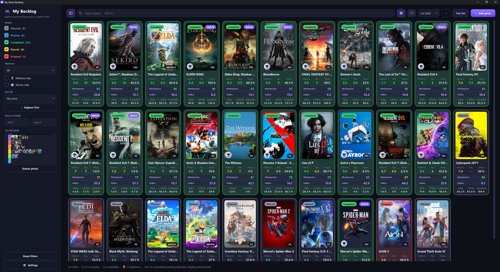
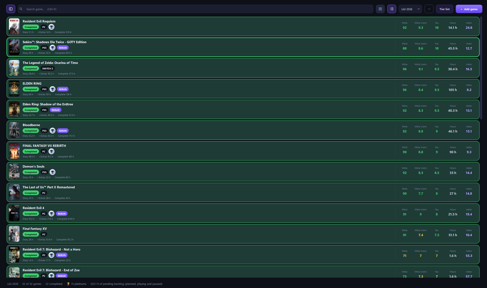
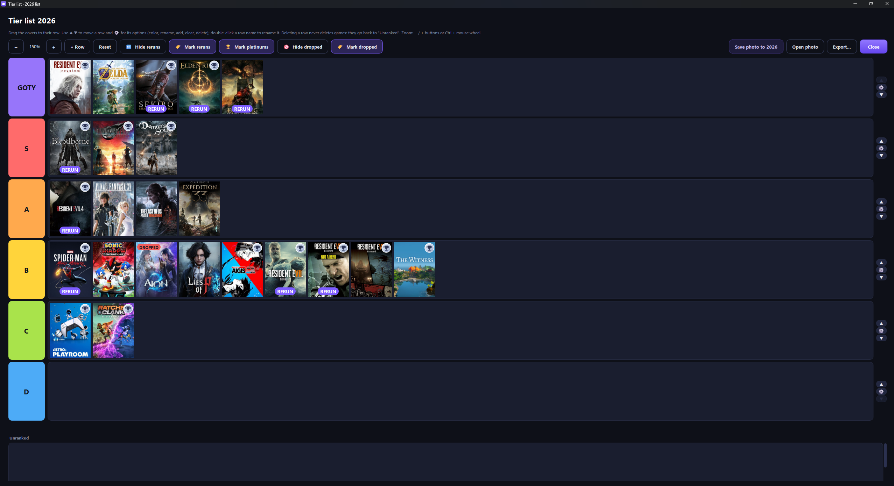
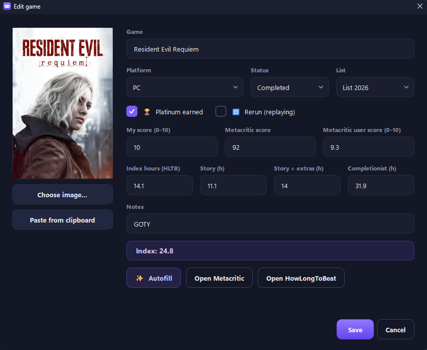

<h1 align="center">🎮 My Game Backlog</h1>

<p align="center">
  Desktop app (Python + PyQt6) to manage your game collection and backlog,<br>
  with scores and playtimes filled in automatically from Steam, HowLongToBeat and Metacritic.
</p>

<p align="center">
  <a href="docs/screenshots/main-cards.png"></a>
</p>

<table>
  <tr>
    <td width="34%" align="center" valign="top">
      <a href="docs/screenshots/main-list.png"></a><br>
      <sub><b>List view</b> with thumbnails and details</sub>
    </td>
    <td width="33%" align="center" valign="top">
      <a href="docs/screenshots/tierlist.png"></a><br>
      <sub><b>Tier list</b> for each year</sub>
    </td>
    <td width="33%" align="center" valign="top">
      <a href="docs/screenshots/game-dialog.png"></a><br>
      <sub><b>Add / edit</b> with autofill</sub>
    </td>
  </tr>
</table>

<p align="center"><sub>Click an image to see it full size. The app is in English by default and can be switched to Spanish.</sub></p>

## Features

- **Cover art** found automatically, or pick an image, paste it from the clipboard or drop it on the dialog (a file or an image dragged from the browser).
- **Title suggestions** while you type, in case you mistype.
- **Platform** (PC, PlayStation, Switch / Switch 2, Nintendo DS / 3DS, Xbox, Emulator…), platinum trophy and a **Rerun** tag for games you are replaying.
- **Metacritic score for the chosen platform.** If Metacritic has no score for it, the app uses the one from another platform **and warns you**; the card keeps a ⚠ mark with that platform (for example `Metascore ⚠ PS4`). You can always pick any platform or type the score by hand.
- **HowLongToBeat hours** (story, story + extras, completionist) and the **Metacritic user score**, filled in as you type the name.
- Your own score and an **index** = Metacritic user score × 10 / √hours (higher score and fewer hours = better index), handy to decide what to play next.
- **Colored statuses** (Planned, Playing, Completed, Paused, Dropped).
- **Filters and sorting** by status (with a count of games in each), platform, platinum, reruns, scores (including the Metacritic user score), min/max hours and index. They are remembered between sessions. The search box also looks in your notes and the platform.
- **Quick actions:** right-click a game to change its status, mark platinum or rerun, move it to another year's list or open it on Metacritic / HowLongToBeat. With the list focused: `Enter` / `F2` edits, `1`–`5` change the status and `Del` deletes.
- **Select several games** with `Ctrl` + click (one by one), `Shift` + click (a range) or `Ctrl+A` (all); `Esc` unselects. Then right-click to change the status of all of them, move or copy them to another list, or delete them; `1`–`5` and `Del` also work on the whole selection.
- **Undo:** deleting a game shows an *Undo* bar for a few seconds (or press `Ctrl+Z`).
- **Duplicate warning** if you add a game that is already in that year's list.
- **One list per year** (move games between years from the dialog or the right-click menu; new / delete list in the `⋯` menu). At the end of the year, `⋯` → *Move or copy games to another list* passes all your Planned games (or the statuses you choose) to next year's list in one go: **move** them, or **copy** them so they also stay in this year's list. Completed games stay where they are, and you can undo it. There is also a **tier list** with covers for each list (Planned games are not included). Rows can be moved, recolored, renamed, added and deleted, reruns can be hidden or tagged, dropped games can be hidden or tagged, platinums can be tagged, and the tier list can be saved as a picture.
- **Card view and list view**, resizable and hideable sidebar showing your tier list for the year.
- **Backup:** export / import everything as a `.zip` (yours or a friend's).
- **Automatic daily copies** of your game list (the last 10). If `games.json` gets damaged, the app keeps the damaged file, loads the newest good copy and tells you.
- **English / Spanish** interface.
- **Themes:** Dark (the default), pure Black and Light, in the ⚙ Settings menu.
- **If a website changes and the app stops getting scores or hours**, use ⚙ Settings → *Update the HowLongToBeat connection*, which installs the newest version of the library that reads HowLongToBeat (Python version; the `.exe` gets it with each app update). Metacritic fixes arrive with the app updates.
- **Updates itself:** ⚙ Settings → *Check for updates* looks at the newest [Release](../../releases) of this repository. If there is a newer version it shows what is new and, if you accept, downloads it, checks it arrived complete, closes the app and opens the new version. Your games are not touched. It works with the portable `.exe` and with the Python version.

## Run it

You need Python 3.9 or newer.

```
pip install -r requirements.txt
python mi_backlog_juegos.pyw
```

Your data is saved in `~/.mi_backlog_juegos/` (on Windows: `C:\Users\<you>\.mi_backlog_juegos\`), outside this folder. The automatic daily copies are in its `backups/auto/` subfolder.

## Build a Windows .exe

```
python -m pip install pyinstaller PyQt6 howlongtobeatpy
python -m PyInstaller --noconfirm --clean --onefile --windowed --name "Mi Backlog de Juegos" --icon mi_backlog_juegos.ico --collect-all howlongtobeatpy mi_backlog_juegos.pyw
```

The result is `dist\Mi Backlog de Juegos.exe`, a single portable file. It works on 64-bit Windows 10/11; if it does not start, install the Microsoft Visual C++ Redistributable 2015-2022 (x64). Windows SmartScreen may warn about an unsigned `.exe`. For faster start-up, build a folder instead: replace `--onefile` with `--onedir` and share the whole folder (a folder build cannot update itself; the single `.exe` can).

## Privacy and notes

- No accounts, API keys or telemetry. The only thing sent to the internet is the game name you type, to Steam, HowLongToBeat and Metacritic (over HTTPS).
- Everything else stays on your computer, in plain-text JSON files and images.
- Metacritic is read from its public web page and HowLongToBeat through the unofficial [`howlongtobeatpy`](https://pypi.org/project/howlongtobeatpy/) library. Neither is an official API, so they may stop working if those sites change. This project is not affiliated with Steam, HowLongToBeat or Metacritic. Use it for personal use and with few requests.

## How it was made

I designed and directed this project: I decided what the app does, how it looks and how it behaves, and I tested and reviewed the result at every step. Much of the code was written with the help of AI coding agents, working from my prompts and instructions about the features and the visual interface.

## Credits

This app only works thanks to these services and libraries. Please keep these credits if you reuse or modify the project:

- **[Steam](https://store.steampowered.com/)** (Valve): cover art, game data and the PC Metacritic score from its public store.
- **[HowLongToBeat](https://howlongtobeat.com/)**: playtimes, through the [`howlongtobeatpy`](https://pypi.org/project/howlongtobeatpy/) library.
- **[Metacritic](https://www.metacritic.com/)**: platform scores and user score, read from its public pages.
- **[PyQt6](https://www.riverbankcomputing.com/software/pyqt/)** (Riverbank Computing): the user interface.

All names, scores, playtimes and images belong to their respective owners.

## License

MIT © 2026 madebydani. See [LICENSE](LICENSE): you can use and modify the code, as long as you keep the copyright notice and license text.

The app depends on PyQt6, which is licensed under GPLv3 (or a commercial license). If you distribute a build that bundles PyQt6, such as the `.exe`, that build must also comply with the GPLv3 terms, which include making the source code available (this repository does). This is not legal advice.

<br>

<details>
<summary><b>🇪🇸 Leer en español</b></summary>

## Qué hace

App de escritorio (Python + PyQt6) para gestionar tu colección y backlog de videojuegos: plataforma, estado, horas, notas, puntuaciones y carátulas, con datos rellenados automáticamente desde Steam, HowLongToBeat y Metacritic.

- **Carátula** automática, o elegida, pegada del portapapeles o soltada sobre el diálogo (un archivo o una imagen arrastrada desde el navegador).
- **Sugerencias de nombres** mientras escribes, por si te equivocas.
- **Plataforma**, platino y etiqueta **Rerun** para los juegos que estás rejugando.
- **Nota de Metacritic de la plataforma elegida.** Si Metacritic no tiene nota para ella, usa la de otra plataforma **y te avisa**; la tarjeta conserva una marca ⚠ con esa plataforma (por ejemplo `Metascore ⚠ PS4`). Siempre puedes elegir cualquier plataforma o escribir la nota a mano.
- **Horas de HowLongToBeat** (historia, historia + extras, completista) y **nota de usuarios de Metacritic**, rellenadas mientras escribes el nombre.
- Tu nota y un **índice** = nota de usuarios de Metacritic × 10 / √horas (más nota y menos horas = mejor índice), útil para decidir a qué jugar.
- **Estados con color** (Planeado, Jugando, Completado, Pausado, Dropeado).
- **Filtros y orden** por estado (con cuántos juegos hay en cada uno), plataforma, platino, reruns, notas (incluida la nota de usuarios de Metacritic), horas mínimas/máximas e índice. Se recuerdan entre sesiones. El buscador también mira en tus notas y en la plataforma.
- **Acciones rápidas:** con clic derecho sobre un juego cambias su estado, marcas platino o rerun, lo mueves a la lista de otro año o lo abres en Metacritic / HowLongToBeat. Con la lista seleccionada: `Enter` / `F2` edita, `1`–`5` cambian el estado y `Supr` lo elimina.
- **Seleccionar varios juegos** con `Ctrl` + clic (de uno en uno), `Mayús` + clic (un rango) o `Ctrl+A` (todos); `Esc` quita la selección. Después, con clic derecho les cambias el estado a todos, los mueves o copias a otra lista, o los eliminas; `1`–`5` y `Supr` también funcionan con toda la selección.
- **Deshacer:** al eliminar un juego aparece una barra con *Deshacer* durante unos segundos (o pulsa `Ctrl+Z`).
- **Aviso de repetidos** si añades un juego que ya está en la lista de ese año.
- **Una lista por año** (los juegos se pueden mover de año desde el diálogo o el clic derecho; crear o borrar listas en el menú `⋯`). Al acabar el año, `⋯` → *Mover o copiar juegos a otra lista* pasa de golpe todos tus Planeados (o los estados que elijas) a la lista del año siguiente: **moverlos**, o **copiarlos** para que se queden también en la de este año. Los completados se quedan donde están, y se puede deshacer. También hay un **tier list** con portadas para cada lista (los Planeados no entran). Los puestos se pueden mover, cambiar de color, renombrar, añadir y eliminar, los reruns se pueden ocultar o marcar con una etiqueta, los dropeados se pueden ocultar o marcar, los platinos se pueden marcar, y el tier list se guarda como foto.
- **Vista de tarjetas y de lista**, menú lateral redimensionable y ocultable con el tier list del año.
- **Copia de seguridad:** exportar / importar todo en un `.zip` (la tuya o la de un amigo).
- **Copias automáticas diarias** de tu lista de juegos (las 10 últimas). Si `games.json` se daña, la app guarda el archivo dañado, carga la copia buena más reciente y te avisa.
- Interfaz en **inglés y español**.
- **Temas:** Oscuro (por defecto), Negro puro y Claro, en el menú ⚙ Ajustes.
- **Si una web cambia y la app deja de recibir notas u horas**, usa ⚙ Ajustes → *Actualizar la conexión con HowLongToBeat*, que instala la versión más nueva de la librería que lee HowLongToBeat (versión de Python; el `.exe` la recibe con cada actualización de la app). Los arreglos de Metacritic llegan con las actualizaciones de la app.
- **Se actualiza sola:** ⚙ Ajustes → *Buscar actualizaciones* mira la última [Release](../../releases) de este repositorio. Si hay una versión más nueva enseña las novedades y, si aceptas, la descarga, comprueba que ha llegado completa, cierra la app y abre la versión nueva. Tus juegos no se tocan. Funciona con el `.exe` portable y con la versión de Python.

## Cómo usarla

Necesitas Python 3.9 o superior.

```
pip install -r requirements.txt
python mi_backlog_juegos.pyw
```

Tus datos se guardan en `~/.mi_backlog_juegos/` (en Windows: `C:\Users\<tu usuario>\.mi_backlog_juegos\`), fuera de esta carpeta. Las copias automáticas diarias están en su subcarpeta `backups/auto/`.

## Crear el .exe

Mira la sección *Build a Windows .exe* de arriba: el comando es el mismo. El resultado, `dist\Mi Backlog de Juegos.exe`, es un único archivo portable para Windows 10/11 de 64 bits.

## Privacidad

No hay cuentas, claves ni telemetría. Lo único que sale a internet es el nombre del juego que escribes, hacia Steam, HowLongToBeat y Metacritic (por HTTPS). El resto se queda en tu ordenador. Metacritic se lee de su página pública y HowLongToBeat con una librería no oficial, así que si esas webs cambian podrían dejar de funcionar. El proyecto no está afiliado a Steam, HowLongToBeat ni Metacritic.

## Cómo se hizo

Diseñé y dirigí este proyecto: decidí qué hace la app, cómo se ve y cómo se comporta, y probé y revisé el resultado en cada paso. Gran parte del código lo escribieron agentes de IA a partir de mis instrucciones (prompts) sobre las funciones y la interfaz visual.

## Créditos y licencia

Funciona gracias a Steam, HowLongToBeat (con la librería `howlongtobeatpy`), Metacritic y PyQt6. Si reutilizas o modificas el proyecto, mantén estos créditos y el aviso de copyright de la licencia MIT. Todos los nombres, notas, tiempos e imágenes pertenecen a sus dueños. Licencia MIT © 2026 madebydani. Como PyQt6 es GPLv3, un `.exe` que lo incluya debe cumplir también esa licencia, que exige tener el código fuente disponible, como en este repositorio.

</details>
